# 🗄️ TQM Pharm Enterprise — Relational Database Architecture & ER Diagram

[-success.svg)]()

This document provides a comprehensive technical reference for the **TQM Pharm Enterprise** relational database architecture, entity-relationship specifications, data dictionary, and concurrency design.

---

## 📐 Visual Entity-Relationship Diagram

> **Vector Graphic Preview**: High-resolution PNG is also available at [`assets/er_diagram.png`](../assets/er_diagram.png).

---

## 📊 Interactive Mermaid Entity-Relationship Diagram

GitHub natively renders the interactive Mermaid diagram below with entities, keys, attributes, and cardinality links:

```mermaid
erDiagram
    %% =======================================================
    %% CLUSTER 1: IDENTITY, SESSION & AUDIT GOVERNANCE
    %% =======================================================
    STAFF ||--o{ ACTIVE_SESSIONS : "maintains"
    STAFF ||--o{ AUDIT_LOGS : "records"
    STAFF ||--o{ PRESCRIPTIONS : "verifies"
    STAFF ||--o{ INVOICES : "bills"
    STAFF ||--o{ DELIVERY_ORDERS : "dispatches"
    STAFF ||--o{ PURCHASE_ORDERS : "authorizes"
    STAFF ||--o{ NARCOTIC_REGISTER : "countersigns"
    STAFF ||--o{ Z_REPORTS : "closes_till"

    %% =======================================================
    %% CLUSTER 2: CLINICAL EHR & CONTROLLED DRUGS
    %% =======================================================
    PATIENTS ||--o{ PRESCRIPTIONS : "presents"
    PATIENTS ||--o{ INVOICES : "billed_to"
    PATIENTS ||--o{ DELIVERY_ORDERS : "receives"
    PATIENTS ||--o{ REFILL_SCHEDULES : "enrolled_in"

    PRESCRIPTIONS ||--o{ NARCOTIC_REGISTER : "mandates_audit"
    MEDICINES ||--o{ NARCOTIC_REGISTER : "controlled_stock"
    MEDICINES ||--o{ REFILL_SCHEDULES : "refill_item"

    %% =======================================================
    %% CLUSTER 3: PHARMACEUTICALS, IOT & SUPPLY CHAIN
    %% =======================================================
    SUPPLIERS ||--o{ PURCHASE_ORDERS : "fulfills"
    MEDICINES ||--o{ TEMPERATURE_LOGS : "monitored_by_iot"
    PURCHASE_ORDERS }o--o{ MEDICINES : "restocks"

    %% =======================================================
    %% CLUSTER 4: POS BILLING & FINANCIAL RECONCILIATION
    %% =======================================================
    INVOICES ||--o{ Z_REPORTS : "settles_into"
    INVOICES ||--o{ DELIVERY_ORDERS : "routes_fulfillment"

    STAFF {
        string id PK "Staff ID (e.g. STF-01)"
        string name "Full Operator Name"
        string role "Admin, Pharmacist, Cashier, Inventory, Delivery"
        string username UK "Unique system handle"
        string password "Salted authentication password"
        string email "Official correspondence email"
        string phone "Staff mobile contact"
        string branch "Assigned branch store"
        string status "Active or Suspended"
    }

    ACTIVE_SESSIONS {
        string session_id PK "UUID session token"
        string user_id FK "References staff(id)"
        string name "Operator Name"
        string role "Active persona role"
        string terminal_name "Assigned physical workstation"
        string ip_address "Client IP address"
        string status "Online or Away"
        string last_action "Last action performed"
        datetime login_time "Session initiation"
        datetime last_heartbeat "Live telemetry ping"
    }

    AUDIT_LOGS {
        int id PK "Autoincrement primary key"
        datetime timestamp "Event recorded time"
        string user_name "Operator username"
        string role "Operator role"
        string action "Event classification"
        string details "Context and payload"
        string level "INFO, WARN, CRITICAL"
    }

    PATIENTS {
        string id PK "Patient ID (e.g. PAT-001)"
        string name "Patient full name"
        int age "Age in years"
        string gender "Gender identifier"
        string phone "Primary contact phone"
        json allergies "List of known drug allergies"
        json chronic_conditions "Hypertension, Diabetes, etc."
        int loyalty_points "Store reward credits"
        string recent_doctor "Last consulting physician"
    }

    MEDICINES {
        string id PK "Medicine SKU (e.g. MED-001)"
        string name "Brand trade name"
        string generic "Active pharmaceutical ingredient"
        string category "Antibiotic, Analgesic, etc."
        string schedule "OTC, Schedule H, H1, or X"
        string manufacturer "Pharma manufacturer"
        string batch "Batch / Lot identifier"
        date expiry "Expiration date (YYYY-MM-DD)"
        int days_to_expiry "Calculated shelf life remaining"
        int stock "Current sellable inventory count"
        string unit "Strips, Bottles, Vials"
        float mrp "Maximum retail price"
        float cost_price "Purchase procurement cost"
        float gst_pct "Applicable GST rate (e.g. 12%)"
        string rack "Warehouse physical rack location"
        int cold_chain "1 if 2-8 deg C storage required"
        json interactions "Interacting drug molecules list"
    }

    PRESCRIPTIONS {
        string rx_id PK "Prescription ID (e.g. RX-2026-001)"
        string patient_name "Patient name"
        string patient_id FK "References patients(id)"
        string doctor_name "Prescribing doctor"
        string hospital "Originating clinic or hospital"
        date date "Prescription issue date"
        string status "Pending, Verified, Dispensed, Rejected"
        json items "Prescribed drugs, dosage, duration"
        string notes "Clinical pharmacist notes"
        string verified_by FK "References staff(name)"
        datetime verified_at "Timestamp of pharmacist sign-off"
    }

    INVOICES {
        string invoice_id PK "Tax Invoice ID (e.g. INV-2026-1001)"
        datetime timestamp "Billing transaction timestamp"
        string patient_name "Customer or patient name"
        string cashier_name FK "References staff(name)"
        string payment_method "Cash, Dynamic UPI QR, Card"
        float subtotal "Pre-tax merchandise subtotal"
        float gst_amount "Calculated CGST + SGST total"
        float total_amount "Final payable invoice total"
        json items_json "Itemized sold items with batch and tax"
    }

    DELIVERY_ORDERS {
        string order_id PK "Shipment ID (e.g. DEL-501)"
        string patient_name "Recipient patient name"
        string address "Delivery physical address"
        string phone "Recipient phone number"
        string agent_name FK "References staff(name)"
        string status "Packaging, Out for Delivery, Delivered"
        string time_slot "Delivery window"
        int items_count "Total packages in shipment"
        int cold_chain_pack "1 if insulated thermal icepack required"
        float amount "Cash on Delivery or prepaid amount"
        string payment_status "Paid or Collect On Delivery"
        string otp "4-digit electronic POD verification PIN"
    }

    NARCOTIC_REGISTER {
        int id PK "Autoincrement entry ID"
        datetime timestamp "Sign-off timestamp"
        string rx_id FK "References prescriptions(rx_id)"
        string patient_name "Patient name"
        string patient_phone "Contact number"
        string doctor_name "Prescribing doctor"
        string doctor_reg_no "Doctor state medical council reg number"
        string medicine_name FK "References medicines(name)"
        string batch_no "Controlled batch number"
        int quantity "Dispensed unit quantity"
        string pharmacist_name FK "Dispensing licensed pharmacist"
        string pharmacist_reg_no "Pharmacist statutory license reg number"
        int auth_pin_verified "1 if PIN authenticated"
    }

    SUPPLIERS {
        string id PK "Supplier ID (e.g. SUP-01)"
        string name "Distributor / vendor business name"
        string contact_person "Representative name"
        string phone "Vendor hotline"
        string email "Purchase order email"
        string gstin "15-digit GST identification number"
        string address "Warehouse logistics address"
        string payment_terms "e.g. 30 Days Net, Immediate UPI"
    }

    PURCHASE_ORDERS {
        string po_id PK "Purchase Order ID (e.g. PO-2026-881)"
        date date "Purchase order issue date"
        string supplier_name FK "References suppliers(name)"
        string status "Pending Delivery or Goods Received"
        json items_json "Procurement line items and rates"
        float total_amount "Total invoice payable amount"
        date received_date "Warehouse receipt date (GRN)"
        string created_by FK "References staff(name)"
    }

    TEMPERATURE_LOGS {
        int id PK "Autoincrement reading ID"
        datetime timestamp "Reading timestamp"
        string sensor_id "IoT probe identifier"
        float temperature "Temperature in deg Celsius"
        string status "Optimal 2-8 deg C or Critical Alert"
        int alert_triggered "1 if excursion alarm fired"
    }

    REFILL_SCHEDULES {
        string id PK "Refill ID (e.g. RF-101)"
        string patient_name "Patient name"
        string patient_phone "Contact phone"
        string medicine_name FK "References medicines(name)"
        date last_dispensed "Date of last fulfillment"
        date next_due_date "Calculated next cycle due date"
        string status "Scheduled, Due Soon, Overdue"
    }

    Z_REPORTS {
        string z_report_id PK "Closure ID (e.g. ZREP-2026-10-20)"
        date report_date "Financial trading date"
        datetime generated_at "Till closure timestamp"
        string generated_by FK "References staff(name)"
        float opening_float "Starting cash drawer float"
        float cash_sales "Total cash tender collected"
        float cash_payouts "Petty expense payouts"
        float expected_cash "opening_float + cash_sales - cash_payouts"
        float actual_cash "Physical drawer cash counted"
        float variance "Discrepancy (Over / Short / Balanced)"
        float upi_sales "Settled dynamic UPI volume"
        float card_sales "Settled POS card terminal volume"
        float total_sales "Gross revenue across all tenders"
        float total_gst "Combined statutory tax collected"
        float cgst "Central GST component"
        float sgst "State GST component"
        int total_bills "Total tax invoices processed"
        string status "CLOSED & SIGNED or AUDIT REVIEW"
        string notes "Cashier shift remarks"
    }
```

---

## 🏛️ Comprehensive 14-Table Data Dictionary

### 1. `staff` — Staff Identity & RBAC
Stores all system operators, credentials, branch assignments, and authorization levels.
| Column | Type | Constraints | Description |
| :--- | :--- | :--- | :--- |
| `id` | `TEXT` | `PRIMARY KEY` | Unique Staff Identifier (e.g., `STF-01`). |
| `name` | `TEXT` | `NOT NULL` | Full Name of the employee. |
| `role` | `TEXT` | `NOT NULL` | RBAC Role (`Admin`, `Pharmacist`, `Cashier`, `Inventory Manager`, `Delivery Agent`). |
| `username` | `TEXT` | `UNIQUE NOT NULL` | Login username handle. |
| `password` | `TEXT` | `NOT NULL` | Local authentication credential. |
| `email` | `TEXT` | `NULLABLE` | Official employee email address. |
| `phone` | `TEXT` | `NULLABLE` | Primary mobile contact. |
| `branch` | `TEXT` | `DEFAULT 'Apex Central - Branch #01'` | Physical dispensary branch location. |
| `status` | `TEXT` | `DEFAULT 'Active'` | Operator state (`Active`, `Suspended`). |

### 2. `active_sessions` — Real-Time Presence & Telemetry
Maintains live connected terminals, heartbeats, and client workstation telemetry.
| Column | Type | Constraints | Description |
| :--- | :--- | :--- | :--- |
| `session_id` | `TEXT` | `PRIMARY KEY` | Unique UUID session token. |
| `user_id` | `TEXT` | `FOREIGN KEY -> staff(id)` | Operator identity link. |
| `name` | `TEXT` | `NOT NULL` | Cached operator name. |
| `role` | `TEXT` | `NOT NULL` | Active workstation role. |
| `terminal_name` | `TEXT` | `NOT NULL` | Assigned station (e.g., `Front Counter A`). |
| `ip_address` | `TEXT` | `DEFAULT '127.0.0.1'` | Client network IP address. |
| `status` | `TEXT` | `DEFAULT 'Online'` | Heartbeat status (`Online`, `Away`, `Logged Out`). |
| `last_action` | `TEXT` | `DEFAULT 'Logged In'` | Last invoked operation descriptor. |
| `login_time` | `TEXT` | `NOT NULL` | ISO timestamp of login event. |
| `last_heartbeat` | `TEXT` | `NOT NULL` | ISO timestamp of last telemetry ping. |

### 3. `audit_logs` — Immutable Security & Operational Audit Trail
Appends all critical system events (auth, inventory adjustments, dispensing, till close).
| Column | Type | Constraints | Description |
| :--- | :--- | :--- | :--- |
| `id` | `INTEGER` | `PRIMARY KEY AUTOINCREMENT` | Monotonically increasing event ID. |
| `timestamp` | `TEXT` | `NOT NULL` | Exact timestamp of event. |
| `user_name` | `TEXT` | `NOT NULL` | Name/ID of operator who triggered event. |
| `role` | `TEXT` | `NOT NULL` | Operational role of user at event time. |
| `action` | `TEXT` | `NOT NULL` | Event classifier (e.g., `DISPENSE_NARCOTIC`). |
| `details` | `TEXT` | `NULLABLE` | JSON or textual payload detailing the action. |
| `level` | `TEXT` | `DEFAULT 'INFO'` | Severity (`INFO`, `WARN`, `CRITICAL`). |

### 4. `medicines` — Drug Master Catalog & FEFO Batch Ledger
Stores pharmaceutical formulations, stock batches, pricing, tax rates, and safety alerts.
| Column | Type | Constraints | Description |
| :--- | :--- | :--- | :--- |
| `id` | `TEXT` | `PRIMARY KEY` | Unique Medicine SKU (e.g., `MED-001`). |
| `name` | `TEXT` | `NOT NULL` | Commercial brand name. |
| `generic` | `TEXT` | `NOT NULL` | Active Pharmaceutical Ingredient (API). |
| `category` | `TEXT` | `NOT NULL` | Therapeutic classification (e.g., `Antibiotic`). |
| `schedule` | `TEXT` | `NOT NULL` | Regulatory schedule (`OTC`, `H`, `H1`, `X`). |
| `manufacturer` | `TEXT` | `NOT NULL` | Manufacturing pharmaceutical laboratory. |
| `batch` | `TEXT` | `NOT NULL` | Manufacturing batch / lot number. |
| `expiry` | `TEXT` | `NOT NULL` | Expiry date (`YYYY-MM-DD`). |
| `days_to_expiry` | `INTEGER` | `NOT NULL` | Pre-computed days remaining until expiration. |
| `stock` | `INTEGER` | `NOT NULL` | Sellable quantity on hand in warehouse. |
| `unit` | `TEXT` | `NOT NULL` | Packaging unit (`Strips`, `Bottles`, `Vials`). |
| `mrp` | `REAL` | `NOT NULL` | Maximum Retail Price (INR). |
| `cost_price` | `REAL` | `NOT NULL` | Inward acquisition cost (INR). |
| `gst_pct` | `REAL` | `NOT NULL` | Statutory GST rate (0%, 5%, 12%, 18%). |
| `rack` | `TEXT` | `NOT NULL` | Physical storage rack and bin coordinate. |
| `cold_chain` | `INTEGER` | `DEFAULT 0` | Flag (1 if 2–8°C refrigerated storage required). |
| `interactions` | `TEXT` | `DEFAULT '[]'` | JSON array of interacting generic compounds. |

### 5. `patients` — Patient Master Directory & EHR
Customer demographics, allergy records, chronic diagnoses, and loyalty tracking.
| Column | Type | Constraints | Description |
| :--- | :--- | :--- | :--- |
| `id` | `TEXT` | `PRIMARY KEY` | Patient unique ID (e.g., `PAT-001`). |
| `name` | `TEXT` | `NOT NULL` | Full legal patient name. |
| `age` | `INTEGER` | `NULLABLE` | Patient age in years. |
| `gender` | `TEXT` | `NULLABLE` | Gender identity. |
| `phone` | `TEXT` | `NOT NULL` | Primary mobile contact. |
| `allergies` | `TEXT` | `DEFAULT '[]'` | JSON array of documented drug allergies. |
| `chronic_conditions`| `TEXT` | `DEFAULT '[]'` | JSON array of ongoing health conditions. |
| `loyalty_points` | `INTEGER` | `DEFAULT 0` | Accrued customer loyalty balance. |
| `recent_doctor` | `TEXT` | `NULLABLE` | Primary attending physician. |

### 6. `prescriptions` — Electronic Prescription (eRx) Queue
Doctor orders, dosages, intake queue, CDSS validation, and verification timestamps.
| Column | Type | Constraints | Description |
| :--- | :--- | :--- | :--- |
| `rx_id` | `TEXT` | `PRIMARY KEY` | Unique Prescription ID (e.g., `RX-2026-001`). |
| `patient_name` | `TEXT` | `NOT NULL` | Receiving patient name. |
| `patient_id` | `TEXT` | `FOREIGN KEY -> patients(id)` | Linked patient entity. |
| `doctor_name` | `TEXT` | `NOT NULL` | Prescribing medical doctor. |
| `hospital` | `TEXT` | `NOT NULL` | Clinic or medical center. |
| `date` | `TEXT` | `NOT NULL` | Date prescribed (`YYYY-MM-DD`). |
| `status` | `TEXT` | `NOT NULL` | State (`Pending Review`, `Verified`, `Dispensed`). |
| `items` | `TEXT` | `NOT NULL` | JSON array of prescribed items and dosages. |
| `notes` | `TEXT` | `NULLABLE` | Clinical remarks or instructions. |
| `verified_by` | `TEXT` | `FOREIGN KEY -> staff(name)` | Pharmacist who authorized the order. |
| `verified_at` | `TEXT` | `NULLABLE` | Pharmacist verification timestamp. |

### 7. `invoices` — Point of Sale & Billing Invoices
Settled commercial transactions, split payments, and statutory GST breakdowns.
| Column | Type | Constraints | Description |
| :--- | :--- | :--- | :--- |
| `invoice_id` | `TEXT` | `PRIMARY KEY` | Statutory Tax Invoice ID (e.g., `INV-2026-1001`). |
| `timestamp` | `TEXT` | `NOT NULL` | Exact transaction settlement timestamp. |
| `patient_name` | `TEXT` | `NOT NULL` | Billed customer name. |
| `cashier_name` | `TEXT` | `FOREIGN KEY -> staff(name)` | Dispensing operator identifier. |
| `payment_method` | `TEXT` | `NOT NULL` | Tender type (`Cash`, `Dynamic UPI QR`, `Card`). |
| `subtotal` | `REAL` | `NOT NULL` | Net merchandise value before tax. |
| `gst_amount` | `REAL` | `NOT NULL` | Cumulative GST amount (CGST + SGST). |
| `total_amount` | `REAL` | `NOT NULL` | Gross payable invoice total. |
| `items_json` | `TEXT` | `NOT NULL` | Itemized line items JSON with batches. |

### 8. `delivery_orders` — Logistics Fleet & e-POD Dispatch
Home delivery orders, live Kanban stages, thermal packing, and OTP proof-of-delivery.
| Column | Type | Constraints | Description |
| :--- | :--- | :--- | :--- |
| `order_id` | `TEXT` | `PRIMARY KEY` | Delivery Tracking ID (e.g., `DEL-501`). |
| `patient_name` | `TEXT` | `NOT NULL` | Customer recipient. |
| `address` | `TEXT` | `NOT NULL` | Physical delivery destination. |
| `phone` | `TEXT` | `NOT NULL` | Recipient contact phone. |
| `agent_name` | `TEXT` | `FOREIGN KEY -> staff(name)` | Assigned delivery agent. |
| `status` | `TEXT` | `NOT NULL` | Stage (`Packaging`, `Out for Delivery`, `Delivered`). |
| `time_slot` | `TEXT` | `NOT NULL` | Scheduled delivery window. |
| `items_count` | `INTEGER` | `NOT NULL` | Total line item count. |
| `cold_chain_pack`| `INTEGER` | `DEFAULT 0` | Flag (1 if ice-pack thermal bag used). |
| `amount` | `REAL` | `NOT NULL` | Invoice order value. |
| `payment_status` | `TEXT` | `NOT NULL` | Status (`Paid Online`, `Collect on Delivery`). |
| `otp` | `TEXT` | `DEFAULT '1234'` | 4-Digit customer handoff verification PIN. |

### 9. `narcotic_register` — Schedule H1 & X Controlled Substances Register
Statutory logbook for high-risk and habit-forming drugs with mandatory PIN countersign.
| Column | Type | Constraints | Description |
| :--- | :--- | :--- | :--- |
| `id` | `INTEGER` | `PRIMARY KEY AUTOINCREMENT` | Monotonically increasing log entry. |
| `timestamp` | `TEXT` | `NOT NULL` | Dispense timestamp. |
| `rx_id` | `TEXT` | `FOREIGN KEY -> prescriptions(rx_id)` | Authorizing prescription reference. |
| `patient_name` | `TEXT` | `NOT NULL` | Patient recipient. |
| `patient_phone` | `TEXT` | `NULLABLE` | Patient phone number. |
| `doctor_name` | `TEXT` | `NOT NULL` | Prescribing medical doctor. |
| `doctor_reg_no` | `TEXT` | `NULLABLE` | Doctor's state medical council registration ID. |
| `medicine_name` | `TEXT` | `FOREIGN KEY -> medicines(name)` | Controlled drug brand name. |
| `batch_no` | `TEXT` | `NOT NULL` | Specific manufacturer batch number. |
| `quantity` | `INTEGER` | `NOT NULL` | Units dispensed. |
| `pharmacist_name`| `TEXT` | `FOREIGN KEY -> staff(name)` | Licensed pharmacist on duty. |
| `pharmacist_reg_no`|`TEXT` | `NOT NULL` | Pharmacist pharmacy council registration number. |
| `auth_pin_verified`|`INTEGER`| `DEFAULT 1` | Verified via secondary security PIN. |

### 10. `suppliers` — Vendor & Distributor Directory
Distributors, wholesale pharmaceutical suppliers, GSTINs, and commercial terms.
| Column | Type | Constraints | Description |
| :--- | :--- | :--- | :--- |
| `id` | `TEXT` | `PRIMARY KEY` | Supplier Code (e.g., `SUP-01`). |
| `name` | `TEXT` | `NOT NULL` | Distributor corporate name. |
| `contact_person`| `TEXT` | `NULLABLE` | Key account manager. |
| `phone` | `TEXT` | `NULLABLE` | Contact telephone. |
| `email` | `TEXT` | `NULLABLE` | Procurement email. |
| `gstin` | `TEXT` | `NULLABLE` | 15-digit GST identification number. |
| `address` | `TEXT` | `NULLABLE` | Distributor warehouse address. |
| `payment_terms` | `TEXT` | `DEFAULT '30 Days Net'` | Credit payment terms. |

### 11. `purchase_orders` — Procurement & Goods Received Notes (GRN)
Supply purchase orders, inbound shipments, and inward inventory reconciliation.
| Column | Type | Constraints | Description |
| :--- | :--- | :--- | :--- |
| `po_id` | `TEXT` | `PRIMARY KEY` | Purchase Order ID (e.g., `PO-2026-881`). |
| `date` | `TEXT` | `NOT NULL` | Order date (`YYYY-MM-DD`). |
| `supplier_name` | `TEXT` | `FOREIGN KEY -> suppliers(name)` | Target vendor entity. |
| `status` | `TEXT` | `NOT NULL` | Status (`Pending Delivery`, `Goods Received`). |
| `items_json` | `TEXT` | `NOT NULL` | JSON list of line items, quantities, and rates. |
| `total_amount` | `REAL` | `NOT NULL` | Cumulative purchase total. |
| `received_date` | `TEXT` | `NULLABLE` | Date physically received and inwarded. |
| `created_by` | `TEXT` | `FOREIGN KEY -> staff(name)` | Operator who created the PO. |

### 12. `temperature_logs` — Cold-Chain IoT Telemetry
Continuous temperature sensor logging for biologicals, insulin, and vaccines (2–8°C).
| Column | Type | Constraints | Description |
| :--- | :--- | :--- | :--- |
| `id` | `INTEGER` | `PRIMARY KEY AUTOINCREMENT` | Telemetry event ID. |
| `timestamp` | `TEXT` | `NOT NULL` | Sensor sample timestamp. |
| `sensor_id` | `TEXT` | `NOT NULL` | Hardware probe ID (e.g., `SENSOR-FRIDGE-01`). |
| `temperature` | `REAL` | `NOT NULL` | Sampled temperature in Celsius. |
| `status` | `TEXT` | `NOT NULL` | Quality state (`Optimal (2-8°C)`, `Excursion Alert`). |
| `alert_triggered`| `INTEGER` | `DEFAULT 0` | 1 if excursion triggered visual alarm. |

### 13. `refill_schedules` — Chronic Patient Refill Adherence
Tracks recurring patient medication schedules, automated reminder flags, and adherence.
| Column | Type | Constraints | Description |
| :--- | :--- | :--- | :--- |
| `id` | `TEXT` | `PRIMARY KEY` | Refill record ID (e.g., `RF-101`). |
| `patient_name` | `TEXT` | `NOT NULL` | Enrolled chronic patient. |
| `patient_phone` | `TEXT` | `NOT NULL` | SMS/WhatsApp contact number. |
| `medicine_name` | `TEXT` | `FOREIGN KEY -> medicines(name)` | Chronic prescription formulation. |
| `last_dispensed`| `TEXT` | `NOT NULL` | Date of last dispensed cycle. |
| `next_due_date` | `TEXT` | `NOT NULL` | Computed next replenishment date. |
| `status` | `TEXT` | `DEFAULT 'Scheduled'` | Adherence status (`Scheduled`, `Due Soon`, `Overdue`). |

### 14. `z_reports` — End-of-Day Financial Till Closure
Daily financial reconciliation, tender verification, cash variance, and tax totals.
| Column | Type | Constraints | Description |
| :--- | :--- | :--- | :--- |
| `z_report_id` | `TEXT` | `PRIMARY KEY` | Financial Closure ID (e.g., `ZREP-2026-10-20`). |
| `report_date` | `TEXT` | `NOT NULL` | Trading date (`YYYY-MM-DD`). |
| `generated_at` | `TEXT` | `NOT NULL` | Timestamp of register closure. |
| `generated_by` | `TEXT` | `FOREIGN KEY -> staff(name)` | Operator closing the register. |
| `opening_float` | `REAL` | `NOT NULL` | Morning opening till cash. |
| `cash_sales` | `REAL` | `NOT NULL` | Cash received through invoices. |
| `cash_payouts` | `REAL` | `NOT NULL` | Petty cash disbursements. |
| `expected_cash` | `REAL` | `NOT NULL` | System expected drawer balance. |
| `actual_cash` | `REAL` | `NOT NULL` | Physical currency counted by cashier. |
| `variance` | `REAL` | `NOT NULL` | `actual_cash - expected_cash` (Short/Over). |
| `upi_sales` | `REAL` | `NOT NULL` | Digital dynamic UPI volume. |
| `card_sales` | `REAL` | `NOT NULL` | POS card merchant volume. |
| `total_sales` | `REAL` | `NOT NULL` | Gross turnover across all tenders. |
| `total_gst` | `REAL` | `NOT NULL` | Combined tax collected. |
| `cgst` | `REAL` | `NOT NULL` | Central GST share. |
| `sgst` | `REAL` | `NOT NULL` | State GST share. |
| `total_bills` | `INTEGER` | `NOT NULL` | Count of invoices settled in shift. |
| `status` | `TEXT` | `DEFAULT 'CLOSED & SIGNED'` | Final audit signing status. |
| `notes` | `TEXT` | `NULLABLE` | Cashier shift variance remarks. |

---

## ⚡ Concurrency & Storage Engine Design

1. **Write-Ahead Logging (WAL)**:
   - Configured via `PRAGMA journal_mode = WAL;`.
   - Allows concurrent readers and writers without database locking conflicts.
2. **Busy Timeout Handling**:
   - `PRAGMA busy_timeout = 5000;` guarantees multi-threaded operations wait up to 5 seconds before failing.
3. **Foreign Key Integrity**:
   - Enforced via `PRAGMA foreign_keys = ON;` on every connection to maintain relational integrity.
4. **Normalized Third Normal Form (3NF)**:
   - Eliminates redundant repeating groups, transitive dependencies, and partial functional dependencies.
